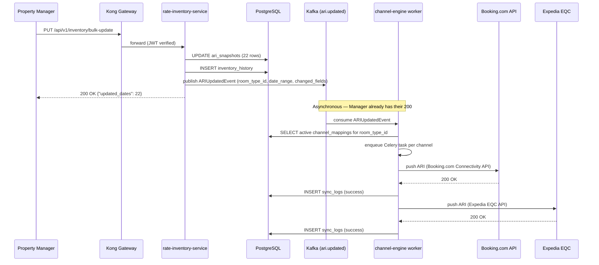
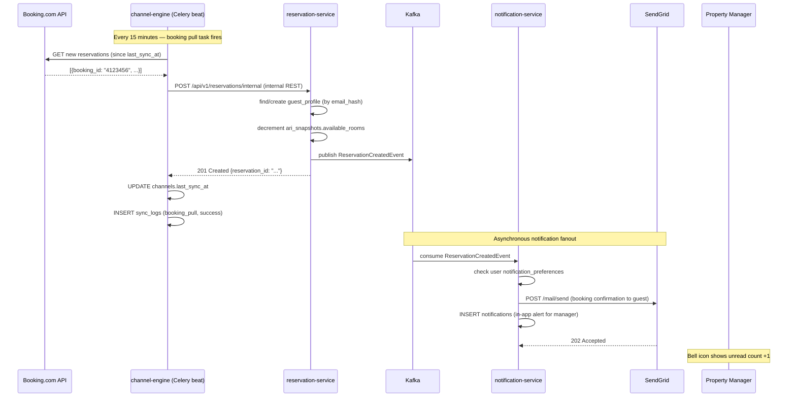

# Communication Patterns

**What you'll learn:**
- When to use synchronous REST vs. asynchronous Kafka events
- How inter-service REST calls work inside the cluster
- The complete Kafka topic registry
- Step-by-step sequence diagrams for the two most important flows

---

## Synchronous Communication — REST via Kong

### When to use REST

Use REST (synchronous) when:
- The user is waiting for a response (login, create reservation, load a page)
- You need to validate data from another service before proceeding
- The operation is a simple read or write with immediate confirmation

### External requests (browser → Kong → service)

All browser requests go through Kong at `http://localhost:8000` (local) or `https://api.kira.abodeab.com` (production). Kong:

1. Matches the path prefix to a service
2. Verifies the JWT Bearer token (except `/health`, `/auth/login`, `/auth/register`)
3. Forwards the request to the internal ClusterIP service
4. Returns the response

**Route mapping in `kong/kong.yml`:**

| External prefix | Internal service | Port |
|---|---|---|
| `/api/v1/auth/*` | identity-service | 8001 |
| `/api/v1/users/*` | identity-service | 8001 |
| `/api/v1/rooms/*` | rate-inventory-service | 8002 |
| `/api/v1/inventory/*` | rate-inventory-service | 8002 |
| `/api/v1/reservations/*` | reservation-service | 8003 |
| `/api/v1/guests/*` | reservation-service | 8003 |
| `/api/v1/channels/*` | channel-engine | 8004 |
| `/api/v1/notifications/*` | notification-service | 8005 |
| `/api/v1/admin/*` | admin-service | 8006 |

### Internal service-to-service REST calls

Some operations require one service to synchronously call another without going through Kong. These use Kubernetes internal DNS names — each service is reachable within the cluster at `http://<service-name>:<port>`:

| Caller | Callee | Why |
|---|---|---|
| channel-engine | reservation-service | Create reservation record from OTA booking pull |
| Any service | identity-service | Validate token for internal protected routes |
| Any service | admin-service | Read tenant config during request processing |

Internal calls use `httpx.AsyncClient` with the internal URL:

```python
# channel-engine calling reservation-service internally
async with httpx.AsyncClient() as client:
    response = await client.post(
        f"{settings.reservation_service_url}/api/v1/reservations/internal",
        json=reservation_payload,
        headers={"X-Service-Token": settings.internal_service_token},
        timeout=10.0,
    )
```

:::warning Never call your own API from a service
If channel-engine needs reservation data, it should either receive it via a Kafka event or call reservation-service's internal REST endpoint directly — never call through Kong. Kong is for external traffic only; internal calls skip it for performance and to avoid circular authentication issues.
:::

---

## Asynchronous Communication — Kafka Events

### When to use Kafka

Use Kafka events (asynchronous) when:
- The caller doesn't need to wait for the downstream operation to complete
- The operation involves I/O that might fail or be slow (OTA API calls)
- Multiple services need to react to the same state change
- You want the caller to be decoupled from the consumers

### Topic naming convention

```
{domain}.{action}       # e.g., ari.updated, reservation.created
{domain}.{action}.dlq   # dead-letter queue for failed messages
```

All topics use lowercase with dots as separators. No underscores in topic names.

---

## Kafka Topic Registry

| Topic | Partitions | Retention | Producer | Consumer(s) | Event Schema |
|---|---|---|---|---|---|
| `ari.updated` | 6 | 7 days | rate-inventory-service | channel-engine | `ARIUpdatedEvent` |
| `reservation.created` | 3 | 30 days | reservation-service | channel-engine, notification-service | `ReservationCreatedEvent` |
| `reservation.cancelled` | 3 | 30 days | reservation-service | channel-engine, notification-service | `ReservationCancelledEvent` |
| `channel.sync.failed` | 3 | 7 days | channel-engine | notification-service | `ChannelSyncFailedEvent` |
| `tenant.created` | 1 | 30 days | admin-service | identity-service | *(inline schema)* |
| `ari.updated.dlq` | 1 | 7 days | channel-engine (on error) | *(manual replay)* | *(raw bytes)* |

**Partition count rationale:**
- `ari.updated` gets 6 partitions because it's the highest-volume topic (every bulk ARI update for every tenant produces multiple messages). Six partitions allow up to 6 parallel consumer instances in channel-engine.
- Reservation topics get 3 partitions — lower volume, but we want ordering within a reservation (all events for one reservation go to the same partition via `reservation_id` key).

---

## Flow 1 — Revenue Manager Updates a Rate

When a property manager changes rates in the dashboard, the change propagates to all connected OTAs asynchronously.



**Key observations:**
- The manager receives `200 OK` as soon as the DB write is done — before any OTA is called
- If Booking.com is slow or down, the manager's request is not affected
- Each OTA push is a separate Celery task, so Expedia failure doesn't block Booking.com

---

## Flow 2 — OTA Booking Arrives → Reservation Created → Guest Notified

When a guest books through Booking.com, the channel-engine pulls the booking and creates it as a KIRA reservation.



**Key observations:**
- channel-engine creates the reservation via internal REST — it doesn't write to `reservations` directly
- notification-service reacts to the same Kafka event independently — adding a new consumer (e.g., a future analytics service) requires zero changes to reservation-service or channel-engine
- Guest email and in-app notification happen in parallel within notification-service

---

## Consumer Group Configuration

Each service that consumes Kafka events uses a dedicated consumer group. Consumer group names are prefixed with the environment:

| Service | Consumer Group (production) | Consumer Group (staging) |
|---|---|---|
| channel-engine | `kira-channel-engine` | `kira-staging-channel-engine` |
| notification-service | `kira-notification-service` | `kira-staging-notification-service` |
| identity-service | `kira-identity-service` | `kira-staging-identity-service` |

The environment prefix ensures staging consumers don't compete with production consumers when both point at the same Kafka cluster.

Prefixes are configured via the `KAFKA_GROUP_ID_PREFIX` environment variable — set to `kira` in production and `kira-staging` in staging (see [Kubernetes overlays](../deployment/kubernetes.md)).
