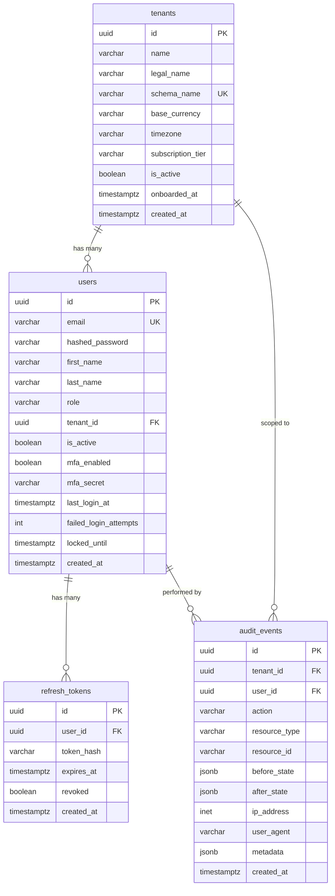
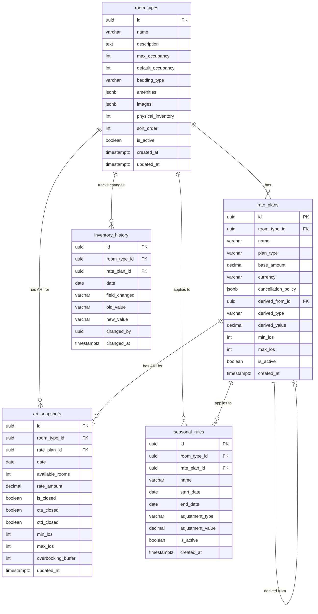
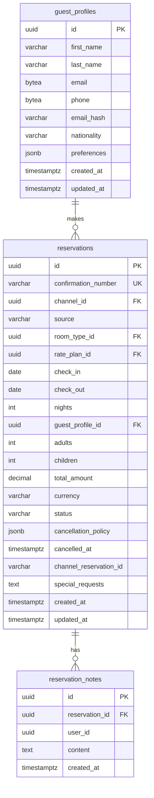
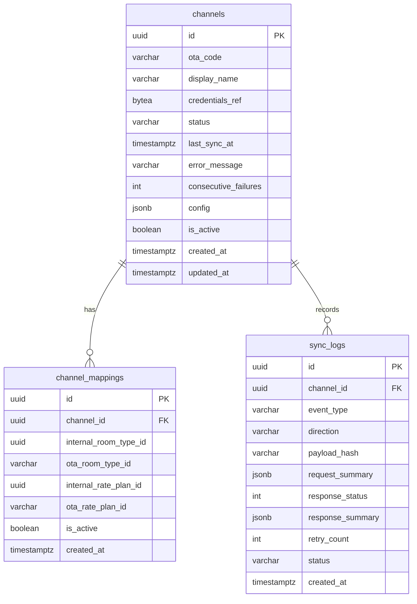
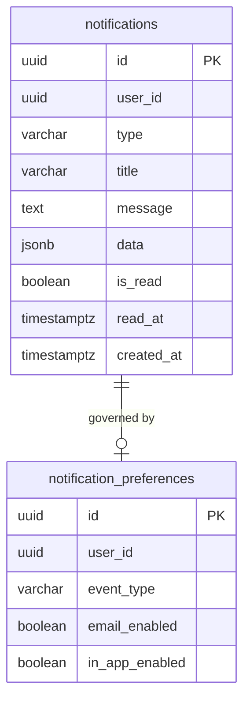

# Database Design

**What you'll learn:**
- The complete schema split between public (global) and tenant (per-hotel) tables
- ER diagrams for each service's owned tables
- Key indexes and why they exist
- How PII fields (guest email, phone, channel credentials) are encrypted at rest
- How Alembic migrations work in a multi-tenant schema setup

---

## Schema Overview

KIRA uses a single PostgreSQL 16 cluster with two levels of tables:
- **`public` schema** — global tables visible to all queries
- **`tenant_{uuid}` schemas** — per-hotel tables, isolated per tenant

See [Multi-Tenancy](./multi-tenancy.md) for how the schema routing works.

---

## Public Schema — Global Tables



**Design decisions:**
- `users.tenant_id` is nullable — super-admin users have `tenant_id = NULL`
- `audit_events` has no `updated_at` — it's append-only and immutable by design
- `users.mfa_secret` stores the encrypted TOTP seed — decrypted only during MFA verification
- `users.token_hash` stores a SHA-256 hash of the refresh token, never the raw token

---

## Rate & Inventory Tables (per tenant)



**Key indexes:**
- `UNIQUE (room_type_id, rate_plan_id, date)` on `ari_snapshots` — prevents duplicate ARI entries and makes UPSERT efficient
- `INDEX (room_type_id, date)` on `ari_snapshots` — calendar range reads: `WHERE room_type_id = ? AND date BETWEEN ? AND ?`

**Derived rate plans:** A rate plan can have `derived_from_id` pointing to a parent rate plan. This supports creating a "Non-Refundable" rate at BAR - 10% without needing to maintain a separate rate. The `derived_value` (e.g., `-10`) and `derived_type` (`percentage`) are applied at read time by the rate plan service.

---

## Reservation Tables (per tenant)



**Key indexes:**
- `INDEX (check_in, check_out)` on `reservations` — occupancy and availability queries
- `INDEX (status)` on `reservations` — dashboard filter by confirmed/cancelled
- `INDEX (email_hash)` on `guest_profiles` — guest deduplication lookup
- `reservations.nights` is a **generated column**: `GENERATED ALWAYS AS (check_out - check_in) STORED`

---

## Channel Engine Tables (per tenant)



**Key design points:**
- `channels.credentials_ref` stores encrypted OTA API credentials as `BYTEA` — decrypted only at sync time
- `channels.consecutive_failures` drives the circuit breaker — see [Event-Driven Architecture](./event-driven.md#circuit-breaker)
- `INDEX (channel_id, created_at DESC)` on `sync_logs` — dashboard sync log queries are always sorted newest-first

---

## Notification Tables (per tenant)



**Key indexes:**
- `INDEX (user_id, is_read, created_at DESC)` on `notifications` — the bell icon query: `WHERE user_id = ? AND is_read = FALSE ORDER BY created_at DESC`
- `UNIQUE (user_id, event_type)` on `notification_preferences` — one preference row per user per event type

---

## PII Encryption Strategy {#pii-encryption}

Guest email addresses, phone numbers, and OTA API credentials are PII or secrets that must be protected at rest. KIRA uses field-level encryption via `shared/utils/crypto.py`.

### How it works

The encryption uses **Fernet** symmetric encryption with a key derived via **PBKDF2HMAC** (480,000 iterations, SHA-256):

```python
# shared/utils/crypto.py
def encrypt(plaintext: str, secret: str) -> str:
    """Returns '<b64-salt>:<b64-ciphertext>' stored as the column value."""
    fernet, salt = derive_fernet_key(secret)
    token = fernet.encrypt(plaintext.encode())
    return f"{b64encode(salt)}:{b64encode(token)}"

def decrypt(token: str, secret: str) -> str:
    """Reverses encrypt(). Requires the same secret."""
    salt_b64, ciphertext_b64 = token.split(":", 1)
    fernet, _ = derive_fernet_key(secret, b64decode(salt_b64))
    return fernet.decrypt(b64decode(ciphertext_b64)).decode()
```

The `secret` key comes from `ENCRYPTION_KEY` environment variable (a 32+ char random string, stored in Kubernetes Secrets).

### Encrypted fields

| Table | Column | Type | Reason |
|---|---|---|---|
| `guest_profiles` | `email` | `BYTEA` | Guest PII |
| `guest_profiles` | `phone` | `BYTEA` | Guest PII |
| `channels` | `credentials_ref` | `BYTEA` | OTA API key/password |

### Searchable encrypted fields

Encrypted data cannot be queried with `=`. For guest deduplication (finding an existing guest by email), `guest_profiles` also stores a **SHA-256 hash** of the email in `email_hash VARCHAR(64)`:

```python
import hashlib

email_hash = hashlib.sha256(email.lower().strip().encode()).hexdigest()
```

Lookups use the hash: `WHERE email_hash = ?`. The hash is deterministic, so the same email always produces the same hash and deduplication works correctly.

:::warning Key rotation
If `ENCRYPTION_KEY` is rotated, all encrypted values must be re-encrypted before the old key is removed. There is no automated rotation script yet — this is a manual process: decrypt all values with the old key, re-encrypt with the new key.
:::

---

## Migration Strategy

### Per-service Alembic chains

Each service maintains its own Alembic migration history. Migrations are independent — rate-inventory's migration chain and reservation's chain never conflict:

```
services/rate-inventory-service/migrations/versions/
├── a1b2c3_initial_schema.py
├── d4e5f6_add_seasonal_rules.py
└── g7h8i9_add_overbooking_buffer.py

services/reservation-service/migrations/versions/
├── j0k1l2_initial_schema.py
└── m3n4o5_add_channel_reservation_id.py
```

### Running migrations

```bash
# Local — single service
cd services/rate-inventory-service
uv run alembic upgrade head

# All services (local dev)
make migrate-all

# Production — Kubernetes Job before deploy
kubectl run alembic-upgrade-rate-inventory \
  --image=${ECR_REGISTRY}/kira-rate-inventory-service:${NEW_TAG} \
  --restart=Never -n kira \
  --env="DATABASE_URL=${DATABASE_URL}" \
  -- uv run alembic upgrade head
```

### Multi-tenant migration (new column added)

When a new migration needs to run against all existing tenant schemas:

```python
# scripts/migrate_all_tenants.py
for tenant in await fetch_all_tenants(db):
    schema = tenant.schema_name  # e.g., "tenant_550e8400_..."
    run_alembic_for_schema(schema, service="rate-inventory-service")
```

This script runs as a K8s Job in CI/CD before the new service version is deployed.

:::tip Write backwards-compatible migrations
The migration job runs while old pods are still serving traffic. Never drop a column or rename a table in a migration unless the old code no longer references it. Use a two-step deploy: code change first (stop using the column), migration second (drop the column).
:::
