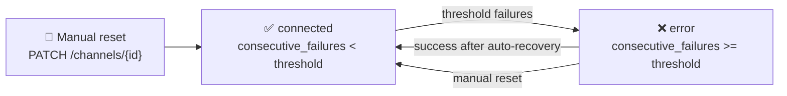

# Event-Driven Architecture

**What you'll learn:**
- Why event-driven is the right model for ARI distribution
- Kafka cluster configuration: topics, partitions, consumer groups
- The exact event schemas defined in `shared/schemas/events.py`
- How failed events are retried and dead-lettered
- The circuit breaker pattern on channel-engine
- How consumers handle duplicate messages safely

---

## Why Event-Driven for ARI Distribution

A hotel channel manager's core job is propagating rate and availability changes to OTAs. The naive approach — calling each OTA's API synchronously in the request handler — has serious problems:

| Problem | Consequence |
|---|---|
| Booking.com API takes 3–15 seconds | Revenue manager waits 30+ seconds for a "rate saved" response |
| Expedia is temporarily down | The PUT /ari request fails even though the DB write succeeded |
| 3 OTAs connected × 30 dates × bulk update | 90 API calls in one request — timeout guaranteed |
| OTA rate limits | Burst of updates (e.g., closing inventory across all dates) hits API limits |

Kafka solves all of these:

1. **Rate-inventory-service** saves to DB, publishes `ari.updated`, returns 200 immediately
2. **Channel-engine Celery workers** consume the event and call OTA APIs asynchronously
3. OTA slowness, downtime, and rate limits are handled in the workers — never in the request path
4. Multiple workers can process multiple OTA pushes in parallel

The tradeoff: OTA sync is **eventually consistent**. There's a delay (usually < 30 seconds) between a rate change and it appearing on Booking.com. For a hotel channel manager this is acceptable — OTAs themselves cache ARI and don't show changes instantly anyway.

---

## Kafka Cluster Configuration

### Topics and partitions

| Topic | Partitions | Key | Retention | Notes |
|---|---|---|---|---|
| `ari.updated` | 6 | `tenant_id` | 7 days | Highest volume topic |
| `reservation.created` | 3 | `reservation_id` | 30 days | Audit retention |
| `reservation.cancelled` | 3 | `reservation_id` | 30 days | Audit retention |
| `channel.sync.failed` | 3 | `tenant_id` | 7 days | |
| `tenant.created` | 1 | `tenant_id` | 30 days | Low volume |
| `ari.updated.dlq` | 1 | — | 7 days | Dead-letter queue |

**Why key by `tenant_id` on `ari.updated`?** Keying by `tenant_id` ensures all events for the same hotel land on the same partition, preserving ordering. If a hotel's rates are updated twice rapidly, the channel-engine consumer processes them in order. Without this, an older update could overwrite a newer one at the OTA.

**Why key by `reservation_id` on reservation topics?** Reservation events (created, modified, cancelled) for the same booking must be processed in order. Keying by `reservation_id` ensures they land on the same partition.

### Consumer groups

```
Kafka topic: ari.updated
    │
    ├── Consumer group: kira-channel-engine
    │   └── 3 consumer instances (3 Celery worker threads each)
    │
    └── (no other consumers for ari.updated)

Kafka topic: reservation.created
    │
    ├── Consumer group: kira-channel-engine
    │   └── closes availability on OTAs
    │
    └── Consumer group: kira-notification-service
        └── sends booking confirmation email
```

Each consumer group maintains its own offset. channel-engine and notification-service both consume `reservation.created` independently — they don't compete, they each get every message.

---

## Event Schemas

All event schemas are defined in `shared/schemas/events.py`. Both producers and consumers import from this shared module — there is no ad-hoc JSON structure anywhere.

### Base envelope

```python
# shared/schemas/events.py
class KiraEvent(BaseModel):
    event_id: uuid.UUID = Field(default_factory=uuid.uuid4)  # for idempotency
    event_type: str                                           # e.g., "ari.updated"
    tenant_id: uuid.UUID                                      # always present
    occurred_at: datetime = Field(default_factory=datetime.utcnow)
    payload: dict[str, Any]
```

Every event has a unique `event_id` (UUID v4, generated at publish time) used for idempotency checks, and an `occurred_at` timestamp for ordering and debugging.

### `ari.updated`

Published by **rate-inventory-service** after any ARI write.

```python
class ARIUpdatedPayload(BaseModel):
    room_type_id: uuid.UUID
    rate_plan_id: uuid.UUID
    date_from: str          # ISO-8601: "2025-06-01"
    date_to: str            # ISO-8601: "2025-06-30"
    rate: float
    availability: int

class ARIUpdatedEvent(KiraEvent):
    event_type: str = "ari.updated"
    payload: ARIUpdatedPayload
```

**Example message:**
```json
{
  "event_id": "a1b2c3d4-e5f6-7890-abcd-ef1234567890",
  "event_type": "ari.updated",
  "tenant_id": "550e8400-e29b-41d4-a716-446655440000",
  "occurred_at": "2025-06-15T10:30:00.123Z",
  "payload": {
    "room_type_id": "660e8400-...",
    "rate_plan_id": "770e8400-...",
    "date_from": "2025-07-01",
    "date_to": "2025-07-31",
    "rate": 8500.00,
    "availability": 4
  }
}
```

---

### `reservation.created`

Published by **reservation-service** after a booking is confirmed.

```python
class ReservationCreatedPayload(BaseModel):
    reservation_id: uuid.UUID
    channel: str            # "booking_com" | "expedia" | "mmt" | "direct"
    room_type_id: uuid.UUID
    rate_plan_id: uuid.UUID
    check_in: str           # ISO-8601 date
    check_out: str
    guest_name: str
    total_amount: float

class ReservationCreatedEvent(KiraEvent):
    event_type: str = "reservation.created"
    payload: ReservationCreatedPayload
```

---

### `reservation.cancelled`

Published by **reservation-service** after a cancellation is processed.

```python
class ReservationCancelledPayload(BaseModel):
    reservation_id: uuid.UUID
    channel: str
    cancelled_at: datetime
    reason: str | None = None

class ReservationCancelledEvent(KiraEvent):
    event_type: str = "reservation.cancelled"
    payload: ReservationCancelledPayload
```

---

### `channel.sync.failed`

Published by **channel-engine** when OTA sync fails after retries are exhausted.

```python
class ChannelSyncFailedPayload(BaseModel):
    channel: str            # OTA code: "booking_com" | "expedia" | "mmt"
    room_type_id: uuid.UUID | None = None
    error_code: str         # e.g., "RATE_PLAN_NOT_MAPPED", "OTA_AUTH_FAILED"
    error_message: str
    retry_count: int = 0

class ChannelSyncFailedEvent(KiraEvent):
    event_type: str = "channel.sync.failed"
    payload: ChannelSyncFailedPayload
```

---

## Retry and Dead-Letter Queue Strategy

The channel-engine Celery task for OTA ARI push uses Celery's built-in retry mechanism with exponential backoff:

```python
# services/channel-engine/app/tasks/ari_push.py
@celery_app.task(
    bind=True,
    max_retries=3,
    default_retry_delay=60,     # 60s → 120s → 240s
    acks_late=True,             # message not acked until task succeeds
)
def push_ari_to_channel(self, tenant_id, channel_id, ...):
    try:
        adapter = get_adapter_for_channel(channel_id)
        adapter.push_ari(...)
        log_sync(channel_id, status="success")
    except OTATemporaryError as exc:
        # Retriable: connection timeout, 503, rate limit
        raise self.retry(exc=exc, countdown=60 * (2 ** self.request.retries))
    except OTAPermanentError as exc:
        # Not retriable: auth failure, mapping missing, hotel deactivated on OTA
        log_sync(channel_id, status="failed", error=str(exc))
        increment_consecutive_failures(channel_id)
        publish_sync_failed_event(channel_id, exc)
```

**Retry schedule:**
- Attempt 1: immediate
- Attempt 2: 60 seconds later
- Attempt 3: 120 seconds later
- Attempt 4: 240 seconds later (final)

If all retries fail, `channel.sync.failed` is published and the sync log records the failure. The event payload includes the error code so notification-service can surface a useful message to the property manager.

### Dead-letter queue

Kafka consumer-level retries (not task retries) use a dead-letter topic. If the consumer fails to process a message after the configured error handler retries, the message is forwarded to `ari.updated.dlq`:

```python
# shared/utils/kafka_helpers.py (consumer error handling)
async def _handle_error(self, msg, exc):
    logger.error("kafka_consumer_failed", topic=msg.topic, offset=msg.offset, exc=str(exc))
    await self.dlq_producer.send(f"{msg.topic}.dlq", value=msg.value, key=msg.key)
```

DLQ messages are monitored by the `KafkaConsumerLag` alert in Prometheus. To replay a DLQ after fixing the root cause, see [Runbooks — Replay DLQ](../operations/runbooks.md#replay-dead-letter-queue-messages).

---

## Circuit Breaker

The channel-engine uses a database-backed circuit breaker to stop hammering an OTA that keeps failing.

**State is stored in the `channels` table** — not in Redis or memory — so it works correctly across multiple Celery worker pods without coordination:

```
channels.consecutive_failures  — incremented on each push failure
channels.status                — "connected" | "error" | "disconnected"
```

```python
# services/channel-engine/app/core/circuit_breaker.py
CIRCUIT_BREAKER_THRESHOLD: int = settings.circuit_breaker_threshold  # default: 5
AUTO_RECOVERY_MINUTES: int = 5

def is_tripped(consecutive_failures: int) -> bool:
    return consecutive_failures >= CIRCUIT_BREAKER_THRESHOLD
```

**Circuit states:**



When a channel is in `error` status:
- ARI push tasks for that channel are skipped (no OTA call, no retry)
- `channel.sync.failed` is published so the property manager is notified
- Auto-recovery: after 5 minutes, one test push is attempted; if it succeeds, `consecutive_failures` is reset and status returns to `connected`

---

## Idempotency — Handling Duplicate Events

Kafka guarantees **at-least-once delivery** — in failure scenarios (consumer crash, network partition), a message may be delivered more than once. Consumers must be idempotent.

### Strategy 1 — Event ID deduplication

Each event has a unique `event_id` (UUID). The channel-engine consumer tracks processed event IDs in Redis with a TTL matching the topic retention period:

```python
async def _handle(self, payload: dict) -> None:
    event_id = payload.get("event_id")
    if event_id and await redis.exists(f"processed_event:{event_id}"):
        logger.info("duplicate_event_skipped", event_id=event_id)
        return

    await self._process(payload)

    if event_id:
        await redis.setex(f"processed_event:{event_id}", 7 * 86400, "1")
```

### Strategy 2 — Upsert semantics in the DB

`ari_snapshots` uses an `ON CONFLICT DO UPDATE` (UPSERT) rather than INSERT + UPDATE. Applying the same ARI update twice produces the same result:

```sql
INSERT INTO ari_snapshots (room_type_id, rate_plan_id, date, rate_amount, available_rooms, ...)
VALUES (?, ?, ?, ?, ?, ...)
ON CONFLICT (room_type_id, rate_plan_id, date) DO UPDATE
    SET rate_amount = EXCLUDED.rate_amount,
        available_rooms = EXCLUDED.available_rooms,
        updated_at = NOW();
```

### Strategy 3 — OTA push idempotency

OTA APIs themselves are idempotent for ARI updates — sending the same rate value twice has no effect. If the exact same ARI push task runs twice (duplicate event), the second OTA call is a no-op.

The sync log records a `payload_hash` so duplicate syncs can be detected in the sync history without calling the OTA again:

```python
payload_hash = hashlib.sha256(json.dumps(ari_payload, sort_keys=True).encode()).hexdigest()
if await sync_log_repo.exists_recent_success(channel_id, payload_hash, within_minutes=5):
    logger.info("ari_push_skipped_duplicate", channel_id=channel_id)
    return
```
