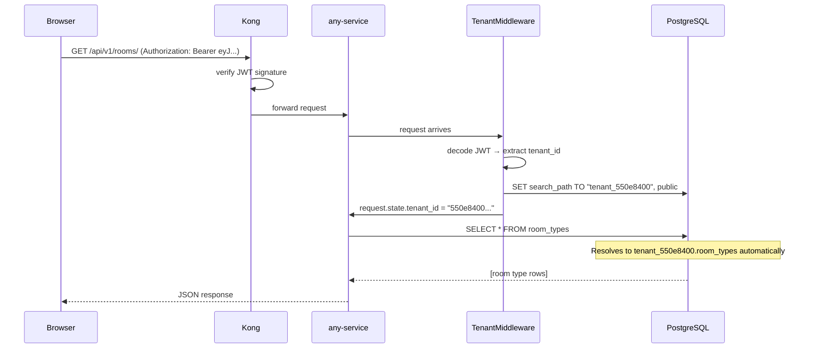
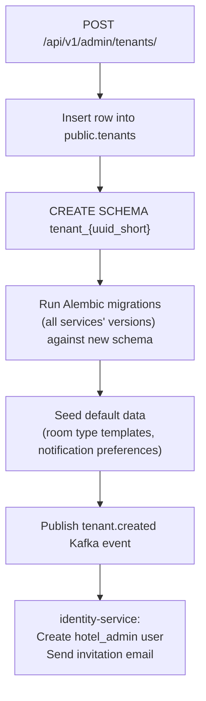

# Multi-Tenancy

**What you'll learn:**
- Why KIRA uses schema-per-tenant instead of row-level isolation
- Exactly how a request gets routed to the right tenant's data
- Which tables live in the public schema and which live in tenant schemas
- The full onboarding flow when a new hotel signs up
- The data isolation guarantees this approach provides

---

## Approach: Schema-Per-Tenant

KIRA uses a **shared PostgreSQL cluster with per-tenant schemas**. One database instance serves all hotels, but each hotel's data lives in a dedicated schema named `tenant_{uuid_short}`:

```
PostgreSQL (one cluster)
│
├── public                  ← global tables
│   ├── tenants
│   ├── users
│   ├── refresh_tokens
│   └── audit_events
│
├── tenant_550e8400...      ← Grand Hotel Demo data
│   ├── room_types
│   ├── rate_plans
│   ├── ari_snapshots
│   ├── reservations
│   ├── channels
│   └── ...
│
├── tenant_6b0f1234...      ← Seaside Inn data
│   ├── room_types
│   ├── ...
│
└── tenant_7c2a5678...      ← Mountain Lodge data
    └── ...
```

**Why not row-level isolation?** Row-level isolation (adding a `tenant_id` column to every table) requires a `WHERE tenant_id = ?` on every query. One missed filter is a data leak. It also means all tenants share the same indexes, which degrades under high load. Schema isolation enforces the boundary at the database level — a query that runs without `search_path` set simply cannot see tenant data.

**Why not a separate database per tenant?** A database per tenant means managing N connection pools, N Alembic migration runs, and N RDS instances. At 100+ tenants this becomes operationally unmanageable. Schema isolation gives isolation without the operational cost.

---

## How Tenant Resolution Works



### Step 1 — JWT contains tenant_id

The identity-service embeds `tenant_id` in the JWT payload at login:

```json
{
  "sub": "user-uuid",
  "tenant_id": "550e8400-e29b-41d4-a716-446655440000",
  "role": "revenue_manager",
  "exp": 1735689600
}
```

### Step 2 — Kong verifies the token

Kong's JWT plugin verifies the token signature before forwarding the request. Tampered tokens are rejected at the gateway — services never receive an unauthenticated request.

### Step 3 — Middleware sets search_path

The `TenantMiddleware` in `shared/middleware/tenant.py` reads `tenant_id` from `request.state` (populated by the auth dependency) and issues a `SET search_path` statement on the SQLAlchemy session:

```python
# shared/middleware/tenant.py
async def set_tenant_search_path(session: AsyncSession, tenant_id: str) -> None:
    schema = f"tenant_{tenant_id.replace('-', '_')}"
    await session.execute(
        sqlalchemy.text(f'SET search_path TO "{schema}", public')
    )
```

The schema name uses underscores (not hyphens) because PostgreSQL identifiers with hyphens require quoting. The UUID `550e8400-e29b-41d4-a716-446655440000` becomes the schema `tenant_550e8400_e29b_41d4_a716_446655440000`.

:::note Why not use hyphens in the schema name?
PostgreSQL allows hyphens in quoted identifiers, but unquoted identifiers cannot contain hyphens. Using underscores throughout eliminates the need for quoting and avoids edge cases in Alembic migration scripts.
:::

### Step 4 — All queries are automatically scoped

After `search_path` is set, every SQLAlchemy query resolves table names to the tenant schema:

```python
# This query has no WHERE clause — it works correctly for every tenant
room_types = await db.execute(select(RoomType))
```

PostgreSQL resolves `room_types` to `tenant_550e8400_e29b_41d4_a716_446655440000.room_types` automatically.

---

## Public Schema vs. Tenant Schema

### Public schema — global tables

Tables in the `public` schema are visible to all queries regardless of `search_path`. They hold data that is either cross-tenant or system-level:

| Table | Service | Why public? |
|---|---|---|
| `tenants` | admin-service | Super-admin needs to read all tenants; tenant provisioning must work before a tenant schema exists |
| `users` | identity-service | Login happens before `search_path` is set; users exist before their tenant schema |
| `refresh_tokens` | identity-service | Token validation is a global operation |
| `audit_events` | identity-service | Super-admin audit queries span all tenants |

### Tenant schema — business tables

All business data lives in the tenant schema. The same table structure exists in every tenant schema — same columns, same constraints, different rows:

| Tables | Service |
|---|---|
| `room_types`, `rate_plans`, `ari_snapshots`, `seasonal_rules`, `blackout_dates`, `inventory_history` | rate-inventory-service |
| `reservations`, `guest_profiles`, `reservation_notes` | reservation-service |
| `channels`, `channel_mappings`, `sync_logs` | channel-engine |
| `notifications`, `notification_preferences` | notification-service |

---

## Tenant Onboarding Flow

When a new hotel signs up (via admin-service):



### Schema creation

The admin-service executes raw SQL to create the schema and then runs each service's Alembic migration chain against it:

```python
# admin-service/app/services/tenant_service.py (simplified)
async def provision_tenant(db: AsyncSession, tenant: Tenant) -> None:
    schema = f"tenant_{str(tenant.id).replace('-', '_')}"

    # Create the schema
    await db.execute(text(f'CREATE SCHEMA IF NOT EXISTS "{schema}"'))

    # Run all service migrations against this schema
    await run_alembic_migrations(schema=schema)

    # Seed defaults
    await seed_default_room_types(db, schema)
    await seed_notification_preferences(db, schema, tenant.admin_user_id)
```

### Rolling out a migration to all tenants

When a new column is added to `ari_snapshots`, the migration must run against every existing tenant schema. The CI/CD pipeline runs migrations as a Kubernetes Job before deploying the new service version:

```python
# scripts/migrate_all_tenants.py
tenants = await fetch_all_tenant_schemas(db)  # SELECT schema_name FROM public.tenants
for schema in tenants:
    run_alembic_for_schema(schema)
```

:::warning Write backwards-compatible migrations
Because migrations run before the new pods deploy, the old pods must still work during the migration window. Never drop a column in the same migration that removes its usage from code. Use a two-step approach:
1. Deploy code that stops using the column (old column still in DB)
2. After deploy, run a migration to drop the column
:::

---

## Data Isolation Guarantees

### What the isolation prevents

- **Cross-tenant data leaks**: A query missing a WHERE clause returns zero rows from other tenants (they're in different schemas)
- **Accidental writes**: An INSERT without `search_path` set fails (no table named `room_types` in `public`)
- **Schema inspection leaks**: `pg_tables` queries scoped to `search_path` only show the current tenant's tables

### What requires care

- **Background jobs**: Celery tasks receive `tenant_id` as a parameter and call `set_tenant_search_path` before any DB access
- **Cross-tenant super-admin queries**: Super-admin operations set `search_path` explicitly to each tenant schema in sequence — never run a cross-tenant join
- **Connection pooling**: PgBouncer must run in **session mode** (not transaction mode) to preserve the `search_path` setting across queries within a request. Transaction mode resets session state between borrowed connections.

### Super-admin access

Super-admins use identity-service with `tenant_id = null` in their JWT. Services that need to support super-admin cross-tenant access explicitly set `search_path` to the target tenant schema using the `tenant_id` from the request path parameter:

```python
# Only for super_admin role
target_tenant_id = request.path_params["tenant_id"]
await set_tenant_search_path(db, target_tenant_id)
```
