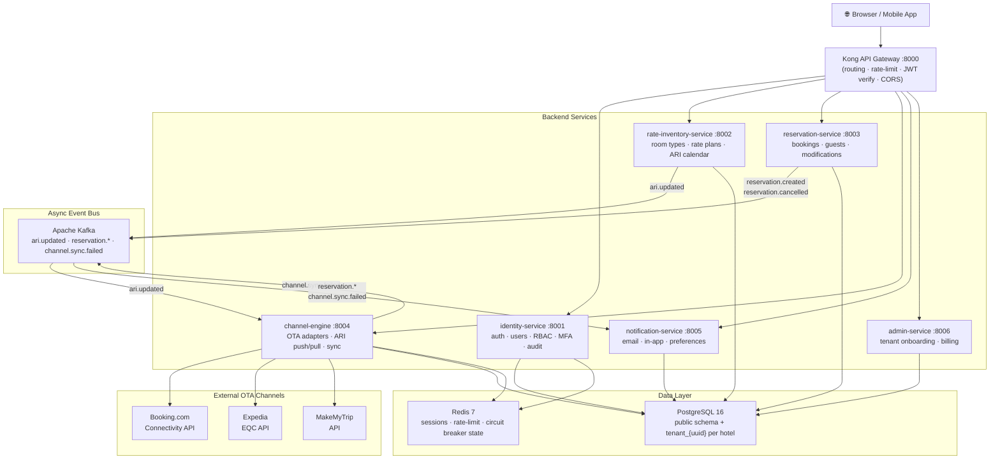

# Architecture Overview

**What you'll learn:**
- The full system topology from browser to database
- The four core design principles behind every architectural decision
- Which service owns which data (the golden rule)
- The communication matrix — who talks to whom and how

---

## System Topology

---

## Design Principles

### 1. Microservices — one domain per service

Each service does exactly one domain job. It has its own codebase, its own database tables, its own Docker image, and its own CI/CD pipeline. You can deploy the channel-engine without touching identity-service.

The boundary rule: **each service owns its data**. The channel-engine never writes directly to the `reservations` table. It publishes an event; reservation-service reacts and writes. This prevents tight coupling and keeps each service independently deployable.

### 2. Event-driven for ARI distribution

Rate and availability updates need to reach all connected OTAs after every change. Doing this synchronously in the request path (PUT /ari → call Booking.com API → call Expedia API → return to user) would make every ARI update take 5–30 seconds and fail if any OTA is temporarily down.

Instead: PUT /ari → save to DB → publish `ari.updated` to Kafka → return 200 immediately → channel-engine consumes the event and pushes to each OTA asynchronously. The UI shows "sync pending" and updates when complete.

### 3. Multi-tenant by schema isolation

All hotel properties share one PostgreSQL cluster. Each tenant gets its own schema (`tenant_{uuid_short}`). No `WHERE tenant_id = ?` clause required on every query — the database session has `search_path` set to the correct schema before the first query runs.

This approach provides hard data isolation (a bug cannot accidentally leak cross-tenant data), clean schema evolution (run migrations once per tenant schema), and good query performance (each tenant's indexes are their own).

### 4. Stateless pods, durable state in the data layer

Application pods hold no state in memory between requests. Sessions are in Redis. Business data is in PostgreSQL. This means any pod can handle any request, and adding replicas requires zero coordination.

---

## Service Ownership Table

The golden rule: if your service needs data it doesn't own, call the owning service's API or consume its events. Never write to another service's tables.

| Service | Port | Tables Owned | Kafka Topics Published |
|---|---|---|---|
| identity-service | 8001 | `public.users`, `public.refresh_tokens`, `public.audit_events` | — |
| admin-service | 8006 | `public.tenants` | `tenant.created` |
| rate-inventory-service | 8002 | `room_types`, `rate_plans`, `ari_snapshots`, `seasonal_rules`, `blackout_dates`, `inventory_history` | `ari.updated` |
| reservation-service | 8003 | `reservations`, `guest_profiles`, `reservation_notes` | `reservation.created`, `reservation.cancelled` |
| channel-engine | 8004 | `channels`, `channel_mappings`, `sync_logs` | `channel.sync.failed` |
| notification-service | 8005 | `notifications`, `notification_preferences` | — |

---

## Communication Matrix

| From → To | Transport | When | Example |
|---|---|---|---|
| Browser → any service | REST via Kong | All user-initiated actions | Login, create reservation |
| rate-inventory → channel-engine | Kafka `ari.updated` | After any ARI write | Rate changed, availability updated |
| reservation → channel-engine | Kafka `reservation.created` | Booking confirmed | Close availability on OTA |
| reservation → notification | Kafka `reservation.created` | Booking confirmed | Send confirmation email |
| reservation → notification | Kafka `reservation.cancelled` | Booking cancelled | Send cancellation email |
| channel-engine → notification | Kafka `channel.sync.failed` | OTA sync exhausted retries | Alert property manager |
| channel-engine → reservation | REST (internal) | OTA booking pulled | Create reservation record |
| any service → identity | REST (internal) | Token introspection | Validate JWT on protected routes |
| admin → identity | Kafka `tenant.created` | New hotel onboarded | Seed default roles |

For the full event catalog with schemas, see [Event-Driven Architecture](./event-driven.md).  
For REST API details, see [Communication Patterns](./communication.md).
