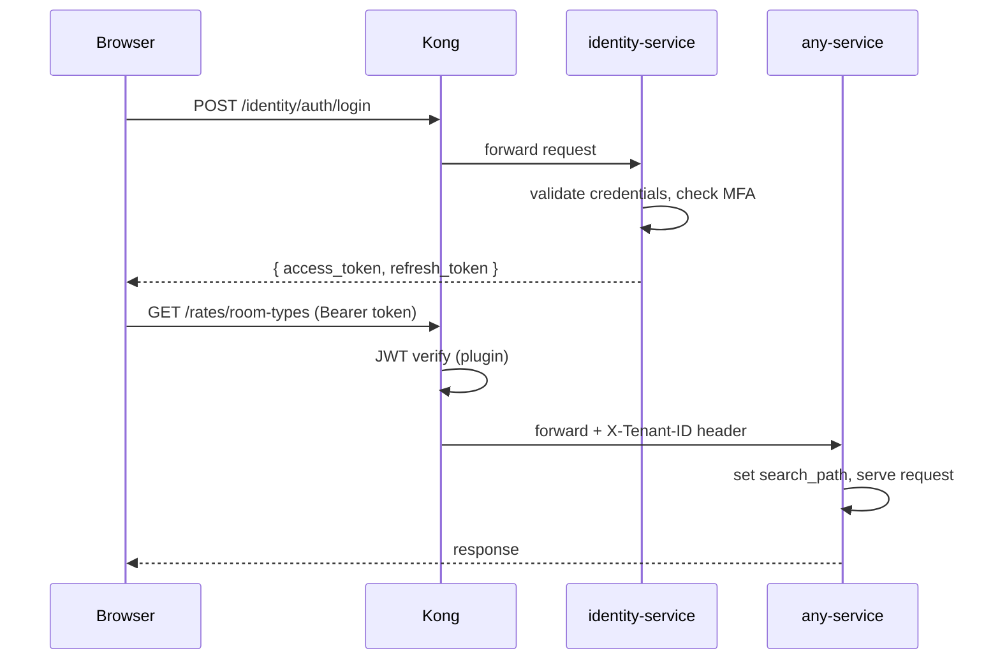

# Security

## Authentication Flow



## JWT Structure

```json
{
  "header": { "alg": "HS256", "typ": "JWT" },
  "payload": {
    "sub": "user_uuid",
    "tenant_id": "tenant_uuid",
    "role": "hotel_admin",
    "email": "manager@hotel.com",
    "iat": 1705312800,
    "exp": 1705316400
  }
}
```

- **Access token:** 60-minute lifetime
- **Refresh token:** 7-day lifetime, stored in HttpOnly cookie
- **Rotation:** refresh token is rotated on every use (one-time use)

## RBAC Roles

| Role | Scope | Capabilities |
|---|---|---|
| `super_admin` | Platform | All tenants, admin-service access |
| `hotel_admin` | Tenant | Full access to their hotel's data |
| `manager` | Tenant | Rates, reservations, channels (no user management) |
| `front_desk` | Tenant | View/modify reservations only |

Permission checks are enforced in the service layer, not the router. Routers only validate input; services enforce authorization.

## MFA (TOTP)

1. User enables MFA in settings
2. identity-service generates a TOTP secret, returns QR code URI
3. User scans with authenticator app (Google Authenticator, Authy)
4. User confirms with 6-digit code — MFA is enabled
5. On login: after password check, user must provide TOTP code
6. Backup codes: 8 single-use codes generated at setup

## Secrets Management

- All secrets injected via environment variables (never hardcoded)
- In Kubernetes: secrets stored as K8s Secret objects, referenced via `secretKeyRef`
- In production: K8s Secrets should be backed by AWS Secrets Manager or Vault
- `.env` files are gitignored — see `secrets-template.yaml` for required keys

## Input Validation

- All request bodies validated by Pydantic v2 schemas
- SQL injection: prevented by SQLAlchemy parameterized queries (never string interpolation)
- XSS: prevented by React's JSX escaping + Content-Security-Policy headers via Kong
- Rate limiting: applied at Kong gateway level (100 req/min per IP by default)

## Audit Log

The identity-service records every permission-sensitive action:

```python
# Every sensitive operation creates an audit entry
await audit_repo.create(AuditLog(
    tenant_id=tenant_id,
    user_id=current_user.id,
    action="rate_plan.update",
    resource_type="RatePlan",
    resource_id=str(rate_plan_id),
    ip_address=request.client.host,
    user_agent=request.headers.get("user-agent"),
    details={"old_rate": 100, "new_rate": 120},
))
```

Audit logs are append-only and retained for 1 year.
