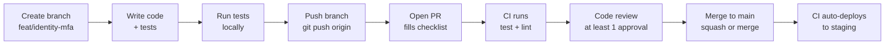

# Development Workflow

**What you'll learn:**

- The full lifecycle from branch to merged PR
- Branch naming and commit message conventions
- How to run the complete test suite locally
- The PR checklist every contributor must complete

---

## Branch to PR Lifecycle



---

## Branch Naming

```
feat/<service>-<feature>     New feature
fix/<service>-<bug>          Bug fix
chore/<topic>                Dependency updates, config changes
docs/<topic>                 Documentation only
refactor/<service>-<topic>   Refactoring without behaviour change
```

Examples:

```bash
git checkout -b feat/identity-mfa-totp
git checkout -b fix/channel-engine-circuit-breaker-reset
git checkout -b docs/api-reference-reservations
git checkout -b chore/update-fastapi-0-115
```

The `<service>` segment must match the service directory name exactly: `identity`, `rate-inventory`, `reservation`, `channel-engine`, `notification`, `admin`.

---

## Commit Message Format

```
type(scope): short imperative description

Optional longer description if the change needs context.
Max 72 chars on the first line.
```

| Type       | When                              |
| ---------- | --------------------------------- |
| `feat`     | New feature                       |
| `fix`      | Bug fix                           |
| `test`     | Adding or fixing tests            |
| `refactor` | Refactoring (no behaviour change) |
| `docs`     | Documentation                     |
| `chore`    | Dependencies, config, tooling     |
| `perf`     | Performance improvement           |

Examples:

```
feat(channel-engine): add MakeMyTrip OTA adapter

fix(identity): refresh token not invalidated on logout

test(reservation): add integration tests for cancellation flow

chore(deps): bump fastapi from 0.111 to 0.115
```

:::tip Commit conventions are enforced
Husky git hooks run **commitlint** on every commit message. If the format is wrong, the commit is rejected. Use `uv run kira commit` or `bun run commit` for an interactive prompt. See [Commit Conventions](./commit-conventions.md) for the full reference.
:::

---

## Git Hooks (Husky)

Three hooks run automatically after `bun install`:

| Hook         | When                         | What it does                                        |
| ------------ | ---------------------------- | --------------------------------------------------- |
| `pre-commit` | Before every commit          | TypeScript type-check + ESLint on `web-app/`        |
| `commit-msg` | After writing commit message | Validates conventional commit format via commitlint |
| `pre-push`   | Before every push            | Runs `make test-all` (all backend tests)            |

If hooks aren't active after a fresh clone, run:

```bash
bun install    # installs Husky and activates hooks
```

---

## Local Development Flow

### Before starting

Pull the latest `main` and create your branch from it:

```bash
git checkout main
git pull origin main
git checkout -b feat/rate-inventory-seasonal-blackout
```

### Running a single service

```bash
# Via CLI
uv run kira dev up
uv run kira dev logs rate-inventory-service

# Or directly with docker compose
docker compose up -d postgres redis kafka
docker compose up -d rate-inventory-service
docker compose logs -f rate-inventory-service
```

### Running tests for one service

```bash
# Via CLI
uv run kira test rate-inventory-service

# Or directly
cd services/rate-inventory-service
uv run pytest -v --cov=app --cov-report=term-missing
```

### Running tests for all services

```bash
# Via CLI
uv run kira test --all

# Or with make
make test-all

# Or manually
docker compose up -d postgres redis kafka

for service in identity-service rate-inventory-service reservation-service channel-engine notification-service admin-service; do
  echo "=== Testing $service ==="
  docker compose exec $service uv run pytest -v --cov=app --cov-fail-under=70
done
```

### Running lint

```bash
# Via CLI
uv run kira lint --all         # All services + web
uv run kira lint --all --fix   # Auto-fix

# Or directly
cd services/identity-service
uv run ruff check .
uv run ruff format --check .

# Auto-fix formatting
uv run ruff format .
```

---

## Pull Request Checklist

Before opening a PR, verify:

- [ ] Branch is up to date with `main` (`git rebase origin/main`)
- [ ] Tests pass locally with `pytest --cov-fail-under=70`
- [ ] No new `ruff` lint errors (`ruff check .`)
- [ ] No `print()` statements — use `structlog`
- [ ] No hardcoded secrets, tokens, or connection strings
- [ ] New endpoints have Pydantic input validation
- [ ] New database columns have an Alembic migration
- [ ] If a Kafka event schema changed, the shared schema in `shared/schemas/events.py` is updated
- [ ] PR title follows `type(scope): description` format
- [ ] PR description explains _what changed_ and _why_ (not just a list of files)

### PR description template

```markdown
## What

Short description of what this PR does.

## Why

The reason for this change — link to issue if applicable.

## Testing

How to manually verify the change (endpoint to hit, expected response).

## Checklist

- [ ] Tests added / updated
- [ ] Migration added (if DB schema changed)
- [ ] Docs updated (if API or behaviour changed)
```

---

## Code Review Guidelines

**As an author:**

- Keep PRs focused — one feature or fix per PR
- Respond to review comments within one business day
- Prefer small, incremental PRs over large all-in-one PRs

**As a reviewer:**

- Review within one business day of assignment
- Approve when you are satisfied, even if minor nits remain (leave them as comments, not change requests)
- Block on: correctness bugs, security issues, missing tests for business logic, hardcoded secrets

**Merge strategy:**

- Use **squash and merge** for feature/fix branches (keeps `main` history clean)
- Use **merge commit** only for long-running feature branches where per-commit history is important

---

## After Merging

Once the PR is merged to `main`:

1. CI runs the service-specific workflow (path-filtered) within ~30 seconds
2. Tests run on the merge commit
3. Docker image is built and pushed to ECR with an 8-char SHA tag
4. The image is deployed to the `kira-staging` namespace automatically
5. Verify the change on staging before requesting a production deploy

Production deploy is manual — see [CI/CD Pipeline](../deployment/cicd-pipeline.md#production-deployment).
