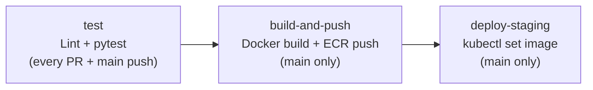
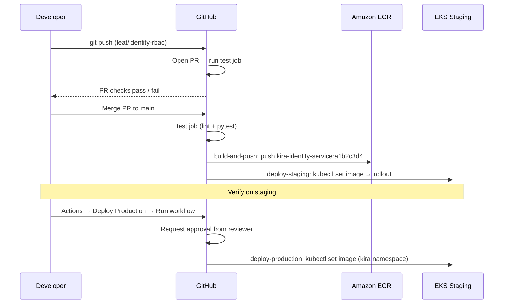

# CI/CD Pipeline

**What you'll learn:**
- How path-filtered triggers prevent unnecessary builds
- The three jobs every service workflow runs: test → build → deploy-staging
- How production deployment works with manual approval
- How to add CI for a new service

---

## Workflow Files

```
.github/workflows/
├── ci-identity-service.yml
├── ci-rate-inventory-service.yml
├── ci-reservation-service.yml
├── ci-channel-engine.yml
├── ci-notification-service.yml
├── ci-admin-service.yml
├── ci-web-app.yml
├── deploy-staging.yml       # manual trigger: deploy any service to staging
└── deploy-production.yml    # manual trigger: deploy any service to production
```

Each service has its own CI workflow. They are structurally identical — only the `SERVICE`, `IMAGE_NAME`, and `WORKDIR` env vars differ.

---

## Path-Filtered Triggers

```yaml
on:
  push:
    branches: [main]
    paths:
      - 'services/identity-service/**'
      - '.github/workflows/ci-identity-service.yml'
  pull_request:
    paths:
      - 'services/identity-service/**'
```

A push to `main` only triggers the identity-service workflow if files under `services/identity-service/` changed. Changing `services/channel-engine/` does not trigger the identity-service build.

**On pull requests:** tests run for any service whose files were changed. Build and deploy do not run on PRs — only on merges to `main`.

:::info Why path filtering matters
Without path filters, every commit would rebuild and redeploy all 7 services. With path filters, only the changed service(s) build. In a team where services change independently, this saves most of the CI cost.
:::

---

## The Three-Job Flow



### Job 1: test

Runs on every PR and every push to `main`.

```yaml
jobs:
  test:
    runs-on: ubuntu-latest
    services:
      postgres:
        image: postgres:16-alpine
        env: { POSTGRES_DB: kira_identity_test, ... }
        options: --health-cmd "pg_isready -U postgres" ...
      redis:
        image: redis:7-alpine
        options: --health-cmd "redis-cli ping" ...
    steps:
      - uses: actions/checkout@v4
      - uses: astral-sh/setup-uv@v4
      - run: uv run poetry install --no-interaction
      - run: uv run ruff check .
      - run: uv run ruff format --check .
      - run: uv run pytest --cov=app --cov-fail-under=70 -v
```

What it does:
1. Spins up real PostgreSQL 16 and Redis 7 service containers
2. Installs deps via `uv run poetry install`
3. Lints with `ruff check` (style/logic errors) and `ruff format --check` (formatting)
4. Runs pytest with coverage — **fails if coverage drops below 70%**

The test database name follows the pattern `kira_<service>_test` so each service has its own isolated test DB.

### Job 2: build-and-push

Runs only when the PR is merged to `main` (`if: github.ref == 'refs/heads/main'`).

```yaml
  build-and-push:
    needs: test
    if: github.ref == 'refs/heads/main'
    steps:
      - uses: aws-actions/configure-aws-credentials@v4
      - uses: aws-actions/amazon-ecr-login@v2
      - id: meta
        run: echo "sha=${GITHUB_SHA::8}" >> $GITHUB_OUTPUT
      - uses: docker/build-push-action@v5
        with:
          context: ${{ env.WORKDIR }}
          push: true
          tags: |
            ${{ registry }}/${{ env.IMAGE_NAME }}:${{ steps.meta.outputs.sha }}
            ${{ registry }}/${{ env.IMAGE_NAME }}:latest
          cache-from: type=gha
          cache-to: type=gha,mode=max
```

Key details:
- **Image tag** is the first 8 characters of the commit SHA (e.g., `a1b2c3d4`). This is what gets deployed and logged.
- **Two tags pushed**: the SHA tag (permanent, used for deploys) and `latest` (convenience pointer).
- **GitHub Actions cache** (`type=gha`) speeds up subsequent builds by caching Docker layers.

### Job 3: deploy-staging

```yaml
  deploy-staging:
    needs: build-and-push
    environment: staging    # ← maps to GitHub Environment named "staging"
    steps:
      - run: aws eks update-kubeconfig --name ${{ secrets.EKS_CLUSTER_NAME }} ...
      - run: |
          kubectl set image deployment/${{ env.SERVICE }} \
            ${{ env.SERVICE }}=${{ secrets.ECR_REGISTRY }}/${{ env.IMAGE_NAME }}:${{ needs.build-and-push.outputs.image-tag }} \
            -n kira-staging
          kubectl rollout status deployment/${{ env.SERVICE }} -n kira-staging --timeout=180s
```

This updates the container image in the staging Deployment and waits up to 3 minutes for the rollout to complete. If the new pods fail their readiness probes, `kubectl rollout status` exits with a non-zero code and the job fails — leaving the old pods running.

---

## Required GitHub Secrets

Set these in **Settings → Secrets and variables → Actions**:

| Secret | Description |
|---|---|
| `AWS_ACCESS_KEY_ID` | IAM user with ECR push + EKS deploy permissions |
| `AWS_SECRET_ACCESS_KEY` | Paired with the above |
| `AWS_REGION` | `ap-south-1` |
| `ECR_REGISTRY` | `123456789.dkr.ecr.ap-south-1.amazonaws.com` |
| `EKS_CLUSTER_NAME` | e.g., `kira-production` |

---

## Production Deployment

Production deployments are **manual** — never automatic. Use the `deploy-production.yml` workflow:

1. Go to **Actions → Deploy — Production → Run workflow**
2. Select the service (or `all`)
3. Enter the 8-char image tag from the staging deploy (visible in the build-and-push job output)
4. GitHub requests approval from the `production` environment's required reviewers
5. After approval, the workflow runs `kubectl set image` for the selected service(s) in the `kira` namespace

```yaml
on:
  workflow_dispatch:
    inputs:
      service:
        type: choice
        options: [all, identity-service, rate-inventory-service, ...]
      image_tag:
        description: '8-char commit SHA from ECR (e.g. a1b2c3d4)'
        required: true
```

:::tip Production approval
Configure the `production` GitHub Environment (Settings → Environments → production) with at least one required reviewer. The workflow will pause at the `environment: production` job until a reviewer approves it in the GitHub UI.
:::

When deploying `all` or `channel-engine`, the workflow also updates the `channel-engine-worker` Deployment automatically.

---

## Pipeline Flow: End to End



---

## Adding CI for a New Service

1. Copy an existing workflow, e.g. `cp .github/workflows/ci-identity-service.yml .github/workflows/ci-my-service.yml`

2. Update the three env vars at the top:

```yaml
env:
  SERVICE: my-service
  IMAGE_NAME: kira-my-service
  WORKDIR: services/my-service
```

3. Update the `paths` trigger:

```yaml
on:
  push:
    paths:
      - 'services/my-service/**'
      - '.github/workflows/ci-my-service.yml'
  pull_request:
    paths:
      - 'services/my-service/**'
```

4. Update the test environment variables to match what the new service needs (database URL, any service-specific secrets).

5. Add the new service to `deploy-production.yml`'s `options` list and the `if: inputs.service == 'all'` branch.

6. Create the ECR repository for the new service (add `aws_ecr_repository` to Terraform).
