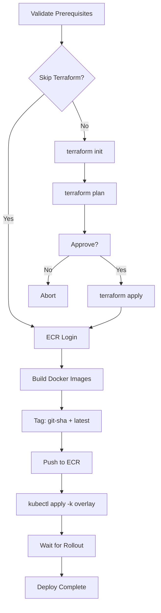

# Deploy Scripts

The KIRA CLI provides manual deployment commands for staging and production environments. These complement the GitHub Actions workflows and are useful for emergency deploys or local testing.

## Prerequisites

Ensure these tools are installed and configured:

| Tool        | Purpose                                       | Install                                                  |
| ----------- | --------------------------------------------- | -------------------------------------------------------- |
| `aws`       | AWS CLI for ECR login + credential validation | [aws.amazon.com/cli](https://aws.amazon.com/cli/)        |
| `terraform` | Infrastructure management                     | [terraform.io](https://www.terraform.io/)                |
| `kubectl`   | Kubernetes cluster management                 | [kubernetes.io](https://kubernetes.io/docs/tasks/tools/) |
| `docker`    | Container builds                              | [docker.com](https://www.docker.com/)                    |

You also need:

- Valid AWS credentials (`aws configure` or environment variables)
- `kubectl` context set to the target EKS cluster (`aws eks update-kubeconfig --name kira-cluster`)

## Staging Deploy

```bash
# Full deploy (Terraform + build + push + kubectl apply)
uv run kira deploy staging

# Skip Terraform (just rebuild + push images + rollout)
uv run kira deploy staging --skip-terraform

# Deploy specific services only
uv run kira deploy staging --services identity-service,admin-service

# Dry run — show what would happen without executing
uv run kira deploy staging --dry-run
```

**What it does:**

1. Validates AWS credentials
2. Runs `terraform init → plan → apply` from `infra/terraform/` _(skippable)_
3. Logs into ECR
4. Builds Docker images for all services (or specified subset)
5. Tags with git SHA + `latest`, pushes to ECR
6. `kubectl apply -k k8s/overlays/staging`
7. Waits for rollout to complete per deployment

**Target:** EKS namespace `kira-staging`

## Production Deploy

```bash
# Full deploy with confirmation prompts
uv run kira deploy production

# Skip infrastructure changes
uv run kira deploy production --skip-terraform

# Deploy only specific services
uv run kira deploy production --services identity-service,web-app

# Preview what would happen
uv run kira deploy production --dry-run
```

:::danger
Production deploys prompt for confirmation twice:

1. Before starting the deploy
2. Before applying Terraform changes

Always use `--dry-run` first to verify the plan.
:::

**Target:** EKS namespace `kira`

## Flags Reference

| Flag                   | Description                                          |
| ---------------------- | ---------------------------------------------------- |
| `--skip-terraform`     | Skip Terraform init/plan/apply phase                 |
| `--services svc1,svc2` | Comma-separated list of services to build and deploy |
| `--dry-run`            | Show execution plan without running anything         |

## Deploy Pipeline



## Relationship to GitHub Actions

| Method                                                                                                                                                     | When to use                                                |
| ---------------------------------------------------------------------------------------------------------------------------------------------------------- | ---------------------------------------------------------- |
| **GitHub Actions** ([deploy-staging.yml](https://github.com/srs-sudeep/kira/actions), [deploy-production.yml](https://github.com/srs-sudeep/kira/actions)) | Standard deploys via PR merge or manual trigger            |
| **CLI (`kira deploy`)**                                                                                                                                    | Emergency hotfixes, local testing, debugging deploy issues |

Both paths produce the same result — Docker images in ECR + kubectl rollout on EKS.

## Rollback

To roll back a deployment:

```bash
# Roll back a single deployment to the previous revision
kubectl rollout undo deployment/identity-service -n kira

# Roll back to a specific revision
kubectl rollout undo deployment/identity-service -n kira --to-revision=3

# Check rollout history
kubectl rollout history deployment/identity-service -n kira
```

Or redeploy the previous git SHA:

```bash
git checkout <previous-sha>
uv run kira deploy production --skip-terraform
```
