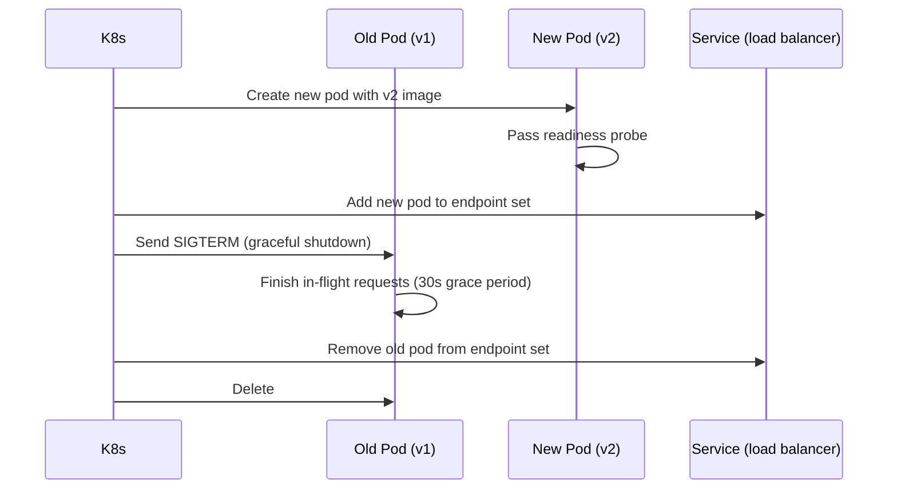

# Kubernetes

For **local clusters** (minikube / kind / Docker Desktop), **dry-runs**, and the **`minikube` overlay** (in-cluster Postgres, Redis, Kafka), see **[Local Kubernetes validation](./local-kubernetes.md)**.

**What you'll learn:**
- The K8s concepts KIRA uses and why
- How the `base/` + `overlays/` Kustomize structure works
- How to apply manifests to staging and production
- How rolling updates and HPAs work in practice

---

## Concepts Used by KIRA

| Concept | What it does in KIRA |
|---|---|
| **Namespace** | `kira` (production), `kira-staging` (staging). Isolates resources between environments on the same cluster. |
| **Deployment** | Declares the desired pod count and pod template for each service. K8s reconciles actual state towards desired state. |
| **Service** | Stable DNS name + ClusterIP for a Deployment. Other pods reach `identity-service` at `http://identity-service:8001` regardless of which pods are running. |
| **HPA** | HorizontalPodAutoscaler. Watches CPU utilisation and adds/removes pods automatically. |
| **ConfigMap** | Non-sensitive shared config (URLs, algorithm names, log level). Mounted as environment variables. |
| **Secret** | Sensitive config (DATABASE_URL, JWT keys, API keys). Base64-encoded, stored separately from the image. |
| **Kustomize** | Config management layer. `base/` holds common manifests; `overlays/` patch them for each environment — no templating language required. |

---

## Manifest Structure

```
k8s/
├── base/
│   ├── kustomization.yaml          # lists all base resources
│   ├── namespace.yaml              # Namespace: kira
│   ├── configmap.yaml              # shared ConfigMap: kira-config
│   ├── secrets-template.yaml       # documents required secret keys (not real values)
│   ├── identity-service/
│   │   ├── deployment.yaml
│   │   ├── service.yaml
│   │   └── hpa.yaml
│   ├── rate-inventory-service/
│   ├── reservation-service/
│   ├── channel-engine/
│   │   ├── deployment.yaml         # API pod
│   │   ├── worker-deployment.yaml  # Celery worker pod
│   │   ├── service.yaml
│   │   └── hpa.yaml
│   ├── notification-service/
│   ├── admin-service/
│   └── web-app/
└── overlays/
    ├── staging/
    │   ├── kustomization.yaml      # namespace kira-staging, 1 replica, ECR images, configmap patch
    │   └── configmap-patch.yaml
    ├── production/
    │   ├── kustomization.yaml      # namespace kira, 2 replicas, max 5 HPA
    │   └── patches/
    │       ├── replicas.yaml       # sets replicas: 2 on all Deployments
    │       └── resources.yaml      # higher CPU/memory limits for API pods
    └── minikube/                   # local cluster: in-cluster Postgres, Redis, Kafka + dev Secrets
        ├── kustomization.yaml
        ├── configmap-patch.yaml
        ├── secrets.yaml
        └── infra/
            ├── postgres.yaml
            ├── redis.yaml
            └── kafka.yaml
```

---

## Base Deployment Template

Every service Deployment follows this pattern (identity-service shown):

```yaml
apiVersion: apps/v1
kind: Deployment
metadata:
  name: identity-service
  namespace: kira
spec:
  replicas: 1                          # overridden by overlays
  selector:
    matchLabels:
      app: identity-service
  template:
    spec:
      terminationGracePeriodSeconds: 30
      containers:
        - name: identity-service
          image: kira-identity-service:latest   # rewritten by kustomize images:
          ports:
            - containerPort: 8001
          env:
            - name: DATABASE_URL
              valueFrom:
                secretKeyRef:
                  name: kira-identity-service-secret
                  key: DATABASE_URL
            - name: ENVIRONMENT
              valueFrom:
                configMapKeyRef:
                  name: kira-config
                  key: ENVIRONMENT
          livenessProbe:
            httpGet: { path: /health, port: 8001 }
            initialDelaySeconds: 10
            periodSeconds: 30
          readinessProbe:
            httpGet: { path: /health, port: 8001 }
            initialDelaySeconds: 5
            periodSeconds: 10
          resources:
            requests: { cpu: 100m, memory: 256Mi }
            limits:   { cpu: 500m, memory: 512Mi }
```

**Liveness probe** — if `/health` fails 3 times in a row, K8s kills and restarts the pod.  
**Readiness probe** — if `/health` fails, K8s stops routing traffic to the pod (but doesn't kill it). This prevents a pod from receiving requests while it's still connecting to the database on startup.

---

## HPA Configuration

```yaml
apiVersion: autoscaling/v2
kind: HorizontalPodAutoscaler
metadata:
  name: identity-service
spec:
  scaleTargetRef:
    apiVersion: apps/v1
    kind: Deployment
    name: identity-service
  minReplicas: 1     # 2 in production overlay
  maxReplicas: 5     # 3 in staging overlay, 5 in production overlay
  metrics:
    - type: Resource
      resource:
        name: cpu
        target:
          type: Utilization
          averageUtilization: 70   # scale up when avg CPU > 70%
  behavior:
    scaleDown:
      stabilizationWindowSeconds: 300   # wait 5 min before scaling down
      policies:
        - type: Pods
          value: 1
          periodSeconds: 60             # remove at most 1 pod per minute
    scaleUp:
      stabilizationWindowSeconds: 60
      policies:
        - type: Pods
          value: 2
          periodSeconds: 60             # add at most 2 pods per minute
```

The scale-down stabilisation window (300s) prevents thrashing — if a burst of traffic ends, the HPA waits 5 minutes before removing pods, in case traffic resumes.

---

## Overlay Differences

| Setting | base | staging overlay | production overlay |
|---|---|---|---|
| Namespace | `kira` | `kira-staging` | `kira` |
| Replicas | 1 | 1 | 2 |
| HPA min | 1 | 1 | 2 |
| HPA max | 5 | 3 | 5 |
| Log level | INFO | DEBUG | INFO |
| CORS origins | (base) | staging.kira.abodeab.com | kira.abodeab.com |
| Kafka group prefix | kira | kira-staging | kira |
| API pod CPU limit | 500m | 500m | 1000m |
| API pod memory limit | 512Mi | 512Mi | 1Gi |

The staging overlay keeps costs low — 1 replica per service, capped at 3 by HPA. The production overlay ensures HA — always 2 pods minimum.

The **`minikube`** overlay uses namespace **`kira-minikube`**, pins HPAs to a single replica, sets **`imagePullPolicy: Never`** for app images tagged **`:local`**, and ships StatefulSet Postgres plus Redis and Kafka — see [Local Kubernetes validation](./local-kubernetes.md).

---

## Applying Manifests

### Staging

```bash
kubectl apply -k k8s/overlays/staging/
```

### Production

```bash
kubectl apply -k k8s/overlays/production/
```

### Minikube (local full stack)

The **`minikube`** overlay deploys Postgres, Redis, and Kafka **inside** the cluster and dev Secrets so all services can start without AWS. Build or load **`kira-*:local`** images first, then:

```bash
kubectl apply -k k8s/overlays/minikube/
```

Full walkthrough: **[Local Kubernetes validation](./local-kubernetes.md)**.

### Preview what Kustomize will generate (dry run)

```bash
kubectl kustomize k8s/overlays/production/
```

This prints the final YAML without applying it — useful for reviewing what Kustomize will generate before applying.

---

## Rolling Updates

When you run `kubectl set image` or `kubectl apply` with a new image tag, K8s performs a rolling update:



Key settings that make this safe:
- `terminationGracePeriodSeconds: 30` — pods have 30 seconds to finish in-flight requests
- `minReplicas: 2` (production) — rolling update never goes below 1 healthy pod
- Readiness probe — new pod only receives traffic after `/health` returns 200

### How to rollback

```bash
# Rollback to previous revision
kubectl rollout undo deployment/identity-service -n kira

# View rollout history
kubectl rollout history deployment/identity-service -n kira

# Rollback to a specific revision
kubectl rollout undo deployment/identity-service --to-revision=3 -n kira
```

---

## Useful kubectl Commands

**Get all pods with status:**

```bash
kubectl get pods -n kira
kubectl get pods -n kira-staging
```

**Tail logs from a running pod:**

```bash
kubectl logs -f deployment/channel-engine -n kira
```

**Open a shell in a running pod:**

```bash
kubectl exec -it deployment/identity-service -n kira -- /bin/bash
```

**Describe a pod (events, probe failures):**

```bash
kubectl describe pod <pod-name> -n kira
```

**Watch HPA scaling decisions:**

```bash
kubectl get hpa -n kira --watch
```

**Force a pod restart (delete triggers a new pod):**

```bash
kubectl rollout restart deployment/notification-service -n kira
```

---

## channel-engine Has Two Deployments

channel-engine is the only service with a separate worker Deployment:

```
channel-engine           → FastAPI API server (handles HTTP requests)
channel-engine-worker    → Celery worker (processes async OTA sync tasks)
```

Both use the same Docker image. The worker's command is `celery -A app.tasks worker --queues=channel`. When deploying channel-engine, the CI workflow updates both Deployments (see `deploy-production.yml`).
