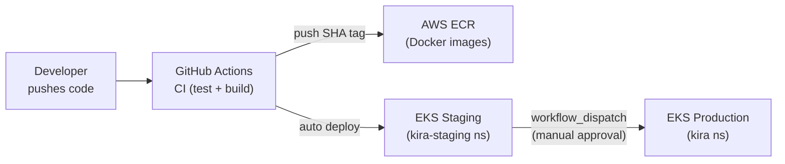

# Deployment Overview

KIRA supports three deployment targets:

| Target | Tool | Use Case |
|---|---|---|
| Local development | Docker Compose | Developer machines |
| Staging | Kubernetes (EKS) | QA and integration testing |
| Production | Kubernetes (EKS) | Live environment |

To **smoke-test `kubectl` and a dev cluster** (Docker Desktop / kind / minikube) and see how that relates to the repo’s `k8s/` manifests, use **[Local Kubernetes validation](./local-kubernetes.md)** — the bundled manifests target EKS-style backing services, not a full laptop stack.

## Deployment Pipeline



## Image Tagging Strategy

- CI builds an image tagged with the short git SHA (`${GITHUB_SHA::8}`)
- Image is pushed to ECR: `{account}.dkr.ecr.{region}.amazonaws.com/kira-{service}:{sha}`
- Staging deployment: `kubectl set image` applies the new SHA tag automatically after CI build
- Production deployment: `workflow_dispatch` with explicit `image_tag` input — human decides when to promote

## Environments

| Namespace | Replicas | HPA | Resources |
|---|---|---|---|
| `kira-staging` | 1 per service | min 1, max 3 | Base (100m/256Mi) |
| `kira` (production) | 2 per service | min 2, max 5 | Higher (200m/256Mi req, 1000m/512Mi limit) |

## Required AWS Infrastructure

- **EKS cluster** — Kubernetes 1.28+
- **ECR repositories** — one per service (`kira-identity-service`, `kira-web-app`, etc.)
- **RDS PostgreSQL 16** — managed database
- **ElastiCache Redis 7** — managed Redis
- **MSK (Managed Kafka)** — managed Kafka cluster
- **IAM roles** — for GitHub Actions OIDC and EKS node groups

## GitHub Actions Secrets Required

```
AWS_ACCOUNT_ID
AWS_REGION
ECR_REGISTRY          # {account}.dkr.ecr.{region}.amazonaws.com
EKS_CLUSTER_NAME
```

These are set as repository secrets in GitHub → Settings → Secrets and variables → Actions.
