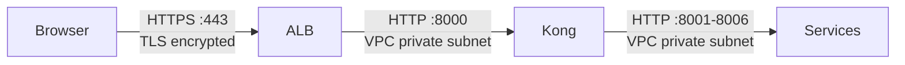

# SSL and Domains

**What you'll learn:**
- How Route 53 DNS records map domains to the ALB
- How ACM issues and auto-renews SSL certificates
- How Kong Ingress terminates TLS
- How HTTP requests are redirected to HTTPS

---

## Domain Structure

| Domain | Target | Purpose |
|---|---|---|
| `kira.abodeab.com` | ALB → web-app pod | Frontend dashboard |
| `api.kira.abodeab.com` | ALB → Kong → services | REST API |
| `staging.kira.abodeab.com` | ALB → staging web-app | Staging frontend |
| `api-staging.kira.abodeab.com` | ALB → staging Kong | Staging API |

---

## Route 53 Setup

All DNS records are defined in Terraform. The pattern for each domain:

```hcl
resource "aws_route53_record" "api" {
  zone_id = aws_route53_zone.kira.zone_id
  name    = "api.kira.abodeab.com"
  type    = "A"

  alias {
    name                   = aws_lb.kira.dns_name
    zone_id                = aws_lb.kira.zone_id
    evaluate_target_health = true
  }
}
```

Use an **A record with an alias** (not a CNAME) to point to the ALB. AWS alias records are free and support health-check evaluation.

### Delegating the subdomain (if the apex domain is elsewhere)

If `abodeab.com` is registered outside AWS, add NS records pointing to the Route 53 hosted zone:

1. Create the hosted zone in Terraform: `aws_route53_zone "kira" { name = "kira.abodeab.com" }`
2. Get the NS records: `terraform output route53_name_servers`
3. Add those four NS records in your external registrar's DNS panel for `kira.abodeab.com`

DNS propagation takes up to 48 hours but usually completes within a few minutes.

---

## SSL Certificate via ACM

```hcl
resource "aws_acm_certificate" "kira" {
  domain_name               = "kira.abodeab.com"
  subject_alternative_names = ["*.kira.abodeab.com"]
  validation_method         = "DNS"

  lifecycle {
    create_before_destroy = true
  }
}
```

Using a wildcard SAN (`*.kira.abodeab.com`) covers all subdomains — `api.`, `staging.`, `api-staging.` — with one certificate.

### DNS validation

After Terraform creates the certificate, ACM provides CNAME records for domain ownership validation. Terraform can create these automatically:

```hcl
resource "aws_route53_record" "cert_validation" {
  for_each = {
    for dvo in aws_acm_certificate.kira.domain_validation_options : dvo.domain_name => {
      name   = dvo.resource_record_name
      type   = dvo.resource_record_type
      record = dvo.resource_record_value
    }
  }

  zone_id = aws_route53_zone.kira.zone_id
  name    = each.value.name
  type    = each.value.type
  records = [each.value.record]
  ttl     = 60
}

resource "aws_acm_certificate_validation" "kira" {
  certificate_arn         = aws_acm_certificate.kira.arn
  validation_record_fqdns = [for record in aws_route53_record.cert_validation : record.fqdn]
}
```

ACM auto-renews certificates 60 days before expiry as long as the DNS validation records remain in place. See [Runbook: SSL Certificate Expiring](../operations/runbooks.md#ssl-certificate-expiring) if you receive an expiry warning.

:::warning ACM certificates must be in us-east-1 for CloudFront
If you later add CloudFront, the ACM certificate must be created in `us-east-1` regardless of the application region. The certificates used for ALB are in `ap-south-1`.
:::

---

## ALB HTTPS Listener

The ALB has two listeners:

```hcl
# HTTPS listener — forwards to Kong target group
resource "aws_lb_listener" "https" {
  load_balancer_arn = aws_lb.kira.arn
  port              = 443
  protocol          = "HTTPS"
  ssl_policy        = "ELBSecurityPolicy-TLS13-1-2-2021-06"
  certificate_arn   = aws_acm_certificate_validation.kira.certificate_arn

  default_action {
    type             = "forward"
    target_group_arn = aws_lb_target_group.kong.arn
  }
}

# HTTP listener — redirects to HTTPS
resource "aws_lb_listener" "http" {
  load_balancer_arn = aws_lb.kira.arn
  port              = 80
  protocol          = "HTTP"

  default_action {
    type = "redirect"
    redirect {
      port        = "443"
      protocol    = "HTTPS"
      status_code = "HTTP_301"
    }
  }
}
```

The SSL policy `ELBSecurityPolicy-TLS13-1-2-2021-06` supports TLS 1.3 and TLS 1.2 only. TLS 1.0 and 1.1 are disabled.

---

## TLS Termination at the ALB

TLS is terminated at the ALB. Traffic between the ALB and Kong pods travels over HTTP within the VPC private subnet — this is acceptable because VPC traffic is isolated and encrypted at the AWS network layer.



If your compliance requirements mandate end-to-end TLS (including ALB → pod), configure Kong with a self-signed certificate and update the ALB target group health check to HTTPS.

---

## Kong and Host-Based Routing

Kong's declarative config (`kong/kong.yml`) uses the `Host` header to route to the correct upstream:

```yaml
services:
  - name: identity-service
    url: http://identity-service:8001
    routes:
      - name: identity-route
        hosts: [api.kira.abodeab.com, api-staging.kira.abodeab.com]
        paths: [/api/v1/auth, /api/v1/users]
```

All HTTPS requests arrive at the ALB with the correct `Host` header preserved. Kong uses this to select the right service.

---

## HTTP to HTTPS Redirect

The ALB HTTP listener returns a 301 redirect for any HTTP request:

```
HTTP/1.1 301 Moved Permanently
Location: https://api.kira.abodeab.com/api/v1/auth/login
```

This is handled entirely at the ALB — Kong never sees HTTP traffic in production.

To verify:

```bash
curl -I http://api.kira.abodeab.com/health
# Expected: HTTP/1.1 301 Moved Permanently
# Location: https://api.kira.abodeab.com/health
```

---

## Checking Certificate Status

```bash
# Via AWS CLI
aws acm describe-certificate \
  --certificate-arn arn:aws:acm:ap-south-1:123456789:certificate/abc123 \
  --region ap-south-1 \
  --query 'Certificate.{Status:Status,NotAfter:NotAfter}'

# Via curl
echo | openssl s_client -connect api.kira.abodeab.com:443 2>/dev/null \
  | openssl x509 -noout -dates
```
