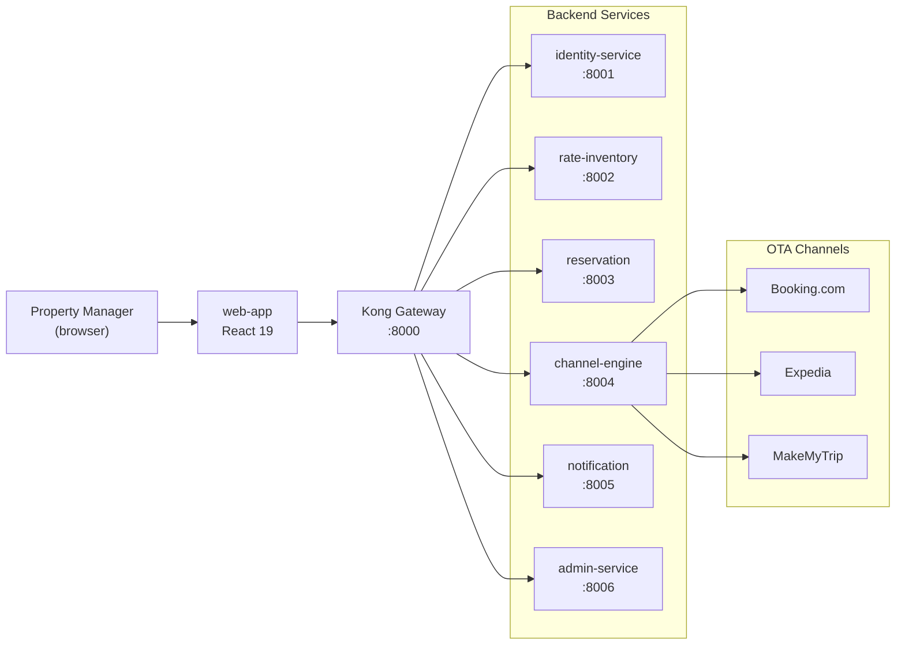

# KIRA Platform

KIRA is a **multi-tenant SaaS hotel channel manager** built for Abode@AB. It lets a hotel property manager update room rates and availability once, then distributes those changes to every connected OTA — Booking.com, Expedia, MakeMyTrip — in real time, and pulls all incoming reservations back into a single dashboard.

The platform is built as a **microservices monorepo**: six independent FastAPI services, a React 19 frontend, PostgreSQL with per-tenant schemas, Kafka for async event distribution, and a Kubernetes-first deployment model on AWS EKS.

---

## Platform at a Glance

---

## Documentation Sections

### Getting Started

Set up the full stack locally and take your first tour of the platform.

- [Prerequisites](./getting-started/prerequisites.md) — tools to install before you begin
- [Local Setup](./getting-started/local-setup.md) — clone, configure, and run with Docker Compose
- [Dev dashboards & ports](./getting-started/dev-dashboards.md) — web app :3000, docs :4000, Grafana/pgAdmin/Portainer sign-in
- [First Run](./getting-started/first-run.md) — walkthrough of creating a tenant, room types, and your first reservation
- [Project Structure](./getting-started/project-structure.md) — monorepo layout explained, folder by folder

### Architecture

How the pieces fit together.

- [Overview](./architecture/overview.md) — system topology, communication patterns, data isolation
- [Microservices](./architecture/microservices.md) — per-service responsibilities and internal layer rules
- [Multi-Tenancy](./architecture/multi-tenancy.md) — per-tenant PostgreSQL schemas and how `search_path` works
- [Event-Driven Design](./architecture/event-driven.md) — Kafka topics, event catalog, consumer groups
- [Security](./architecture/security.md) — JWT auth flow, RBAC roles, MFA, audit log

### Services

Deep-dives on each backend service.

- [Identity Service](./services/identity-service.md) — auth, users, RBAC, MFA, audit
- [Rate & Inventory Service](./services/rate-inventory-service.md) — room types, rate plans, ARI calendar
- [Reservation Service](./services/reservation-service.md) — bookings, guests, cancellation policy
- [Channel Engine](./services/channel-engine.md) — OTA adapters, ARI push/pull, Celery workers
- [Notification Service](./services/notification-service.md) — email, in-app alerts, preferences
- [Admin Service](./services/admin-service.md) — tenant onboarding, billing, super-admin ops

### Frontend

The React 19 property manager dashboard.

- [Overview](./frontend/overview.md) — tech stack, project structure, feature list
- [Architecture](./frontend/architecture.md) — routing, API layer, form and component patterns
- [State Management](./frontend/state-management.md) — TanStack Query vs. Zustand, query key strategy
- [Feature Modules](./frontend/feature-modules.md) — per-feature structure and adding new modules

### API Reference

Every endpoint documented with request/response examples.

- [Overview](./api-reference/overview.md) — conventions, auth, error format, status codes
- [Authentication](./api-reference/authentication.md) — login, MFA, token refresh
- [Rate & Inventory](./api-reference/rate-inventory.md) — room types, rate plans, ARI bulk update
- [Reservations](./api-reference/reservations.md) — create, modify, cancel bookings
- [Channels](./api-reference/channels.md) — connect OTAs, manage mappings, view sync log

### Deployment

From Docker Compose to production on AWS EKS.

- [Overview](./deployment/overview.md) — environments, image tagging, required AWS infrastructure
- [Docker](./deployment/local-docker.md) — Compose setup, Dockerfiles, observability stack
- [Kubernetes](./deployment/kubernetes.md) — Kustomize base + overlays, secrets, resource config
- [Local Kubernetes validation](./deployment/local-kubernetes.md) — dev cluster smoke tests vs EKS
- [CI/CD](./deployment/cicd-pipeline.md) — GitHub Actions pipelines, path filters, production approval gate
- [Deploy Scripts](./deployment/deploy-scripts.md) — Manual CLI-based deployment to staging/production

### Operations

Running the platform in production.

- [Monitoring](./operations/monitoring.md) — Prometheus metrics, Grafana dashboards, SLOs, alerts
- [Logging](./operations/logging.md) — structlog JSON format, Loki, LogQL query examples
- [Runbooks](./operations/runbooks.md) — OTA sync failures, pod crashes, Kafka lag, rollbacks

### Contributing

How to add features, fix bugs, and keep the codebase healthy.

- [Development Workflow](./contributing/development-workflow.md) — branch naming, commit format, PR process
- [Coding Standards](./contributing/coding-standards.md) — Python and TypeScript style rules
- [Testing Guide](./contributing/testing-guide.md) — pytest patterns, Vitest, coverage gate
- [Commit Conventions](./contributing/commit-conventions.md) — Husky hooks, Commitizen, Commitlint

---

## Choose Your Path

### I'm setting up locally for the first time

→ The fastest path: install the prerequisites then run `uv run kira dev setup` — see the **[CLI Reference](./getting-started/cli-reference.md)**. Or follow the step-by-step **[Local Setup](./getting-started/local-setup.md)** guide.

### I'm deploying to production

→ Go to **[Deployment Overview](./deployment/overview.md)** for the AWS infrastructure requirements, then **[Kubernetes](./deployment/kubernetes.md)** for the Kustomize manifests, and **[CI/CD](./deployment/cicd-pipeline.md)** for the GitHub Actions pipeline setup. For manual deploys, see **[Deploy Scripts](./deployment/deploy-scripts.md)**.

### I'm adding a feature to an existing service

→ Read **[Coding Standards](./contributing/coding-standards.md)** and the relevant **[Service](./services/identity-service.md)** doc first so you understand the layer rules, then **[Development Workflow](./contributing/development-workflow.md)** for branch and PR requirements. Commits must follow **[Commit Conventions](./contributing/commit-conventions.md)**.

### I'm debugging a production issue

→ Jump straight to **[Runbooks](./operations/runbooks.md)** for step-by-step procedures, or **[Monitoring](./operations/monitoring.md)** to navigate to the right Grafana dashboard.
