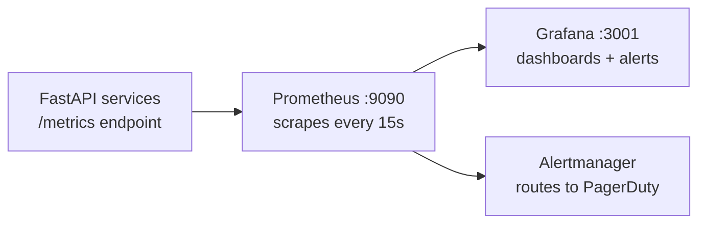

# Monitoring

**What you'll learn:**
- How Prometheus scrapes metrics from each service
- Which dashboards exist in Grafana and what they show
- How to create a custom dashboard for a new metric

---

## Stack Overview



**Local dev:** Prometheus and Grafana run via `docker-compose.observability.yml`. Default Grafana login: `admin` / `admin` at `http://localhost:3001`.

**Production:** Prometheus and Grafana run as pods in the `kira-monitoring` namespace, provisioned via Helm (kube-prometheus-stack).

---

## Prometheus Configuration

Prometheus scrape config is at `observability/prometheus/prometheus.yml`:

```yaml
global:
  scrape_interval: 15s
  evaluation_interval: 15s

scrape_configs:
  - job_name: identity-service
    static_configs:
      - targets: [identity-service:8001]
    metrics_path: /metrics

  - job_name: rate-inventory-service
    static_configs:
      - targets: [rate-inventory-service:8002]
    metrics_path: /metrics

  # ... repeated for all 6 services
```

In Kubernetes, Prometheus uses ServiceMonitor CRDs (from kube-prometheus-stack) to auto-discover pods that expose `/metrics`.

---

## What Each Service Exposes

All services use the `prometheus-fastapi-instrumentator` library, which auto-instruments FastAPI and exposes metrics at `/metrics`.

### Standard HTTP metrics (all services)

| Metric | Type | Description |
|---|---|---|
| `http_requests_total` | Counter | Request count by method, path, status code |
| `http_request_duration_seconds` | Histogram | Latency distribution by endpoint |
| `http_request_size_bytes` | Histogram | Request body size |
| `http_response_size_bytes` | Histogram | Response body size |

### Custom metrics by service

**channel-engine**

| Metric | Type | Description |
|---|---|---|
| `channel_sync_total` | Counter | OTA sync attempts by channel and status |
| `channel_sync_duration_seconds` | Histogram | Time per OTA sync |
| `circuit_breaker_state` | Gauge | 0=closed, 1=open per channel |
| `ari_push_total` | Counter | ARI push attempts by OTA |

**reservation-service**

| Metric | Type | Description |
|---|---|---|
| `reservations_created_total` | Counter | New reservations by source (direct/OTA) |
| `reservations_cancelled_total` | Counter | Cancellations by reason |

**notification-service**

| Metric | Type | Description |
|---|---|---|
| `notifications_sent_total` | Counter | Notifications by type and status |
| `kafka_consumer_lag` | Gauge | Consumer lag per topic |

---

## Grafana Dashboards

Dashboards are provisioned from `observability/grafana/provisioning/dashboards/`. Changes to JSON files are picked up on Grafana restart.

### Service Health Dashboard

Shows per-service: request rate, error rate (5xx), p50/p95/p99 latency.

Key panels:
- **Request rate (rps):** `rate(http_requests_total{job="$service"}[5m])`
- **Error rate (%):** `rate(http_requests_total{status=~"5.."}[5m]) / rate(http_requests_total[5m]) * 100`
- **p95 latency:** `histogram_quantile(0.95, rate(http_request_duration_seconds_bucket[5m]))`

### Channel Sync Dashboard

Shows OTA sync health for each connected channel.

Key panels:
- **Sync success rate by channel**
- **Circuit breaker state** — red when a channel is open-circuited
- **Sync lag** — time since last successful sync per channel

### Kafka Consumer Lag Dashboard

Shows consumer group lag per topic. A rising lag on `ari.updated` means channel-engine is falling behind ARI updates.

Key panels:
- **Lag by topic and consumer group**
- **Messages consumed per second**
- **Partition leader distribution**

### Infrastructure Dashboard

Shows PostgreSQL, Redis, and Kafka infrastructure metrics scraped via exporters (postgres_exporter, redis_exporter).

---

## Creating a Custom Dashboard

1. In Grafana, click **+** → **New Dashboard** → **Add new panel**
2. In the query editor, select the `Prometheus` data source
3. Enter a PromQL expression, e.g.:

```promql
# Sync failure rate for Booking.com
rate(channel_sync_total{channel="booking_com", status="failed"}[5m])
```

4. Set the panel title, unit, and thresholds
5. Click **Save dashboard** → give it a name
6. Export as JSON: **Dashboard settings → JSON Model → Copy to clipboard**
7. Save the JSON to `observability/grafana/provisioning/dashboards/<name>.json` so it is version-controlled and auto-provisioned

:::tip Use variables for service/channel selectors
Add a dashboard variable (Settings → Variables) with a `label_values(job)` query so a single dashboard works for all services with a dropdown selector.
:::

---

## Key Alerts

Alerts are defined in Prometheus alerting rules and routed to Alertmanager. See [Alerting](./alerting.md) for the full alert catalogue and escalation policy.

Quick reference:

| Alert | Condition | Severity |
|---|---|---|
| ServiceDown | No scrape for 2 minutes | Critical |
| HighErrorRate | 5xx rate > 5% for 5 min | Warning |
| ChannelSyncFailing | `circuit_breaker_state == 1` | Warning |
| KafkaConsumerLagHigh | Lag > 1000 for 10 min | Warning |
| HighLatency | p95 > 2s for 5 min | Warning |
