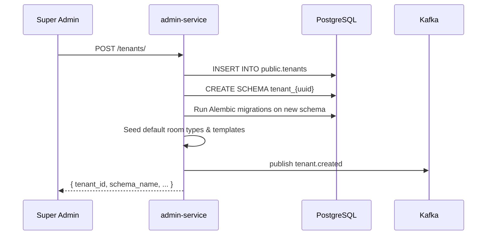

# Admin Service

Super-admin operations, tenant lifecycle management, and billing. Runs on port **8006**.

## Responsibilities

- Provision new hotel tenants (create schema, seed data)
- Manage tenant configuration and feature flags
- Stripe subscription management and billing
- Platform-wide metrics and usage statistics
- Super-admin only — not accessible to hotel users

## Key Endpoints

### Tenants

| Method | Path | Description |
|---|---|---|
| `GET` | `/tenants/` | List all tenants |
| `POST` | `/tenants/` | Provision new tenant |
| `GET` | `/tenants/{id}` | Tenant details |
| `PATCH` | `/tenants/{id}` | Update tenant settings |
| `POST` | `/tenants/{id}/suspend` | Suspend tenant |
| `POST` | `/tenants/{id}/reactivate` | Reactivate tenant |

### Billing

| Method | Path | Description |
|---|---|---|
| `GET` | `/tenants/{id}/billing` | Subscription details |
| `POST` | `/tenants/{id}/billing/subscribe` | Create subscription |
| `POST` | `/tenants/{id}/billing/cancel` | Cancel subscription |
| `POST` | `/webhooks/stripe` | Stripe webhook handler |

### Platform Metrics

| Method | Path | Description |
|---|---|---|
| `GET` | `/metrics/overview` | Platform stats (tenants, users, reservations) |
| `GET` | `/metrics/tenants/{id}` | Per-tenant usage stats |

## Tenant Provisioning Flow



## Data Models

### Tenant

```python
class Tenant(Base):
    __tablename__ = "tenants"
    __table_args__ = {"schema": "public"}

    id: UUID
    schema_name: str          # "tenant_{uuid}"
    hotel_name: str
    hotel_address: str | None
    hotel_city: str | None
    hotel_country: str | None
    hotel_phone: str | None
    hotel_email: str | None
    hotel_website: str | None
    hotel_star_rating: int | None
    timezone: str             # e.g., "Asia/Kolkata"
    currency: str             # e.g., "INR"
    status: TenantStatus      # active | suspended | trial
    plan: BillingPlan         # trial | starter | professional | enterprise
    stripe_customer_id: str | None
    stripe_subscription_id: str | None
    created_at: datetime
    trial_ends_at: datetime | None
```

## Tenant Settings API

Hotel admins can update their own property settings via a `/settings/property` endpoint in the admin-service (accessible to `hotel_admin` role for their own tenant):

```json
{
  "hotel_name": "Grand Hotel Example",
  "hotel_address": "123 Main Street",
  "hotel_city": "Mumbai",
  "hotel_country": "IN",
  "hotel_phone": "+91-22-1234-5678",
  "hotel_email": "info@grandhotel.com",
  "hotel_website": "https://grandhotel.com",
  "hotel_star_rating": 4,
  "timezone": "Asia/Kolkata",
  "currency": "INR"
}
```

## Stripe Integration

- Subscriptions managed via Stripe Checkout
- Webhook events: `invoice.paid`, `invoice.payment_failed`, `customer.subscription.deleted`
- Failed payments trigger in-app notification + email to hotel admin
- Grace period: 3 days after payment failure before suspension
